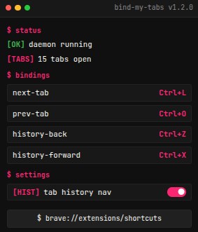

# bind-my-tabs

Minimalist tab switching daemon for Brave / Chromium.

  

## Architecture

- Manifest V3 backend (`chrome.commands` + keyboard event capture)
- Prevents default shortcut conflicts (e.g. `Ctrl+O` open file, `Ctrl+L` omnibox) across Chromium browsers

## Install

1. Open `brave://extensions` (or `chrome://extensions`)
2. Enable **Developer mode**
3. Click **Load unpacked** and select this directory

## Configure Shortcuts

Open `brave://extensions/shortcuts` (or `chrome://extensions/shortcuts`):
- `next-tab`
- `prev-tab`
- `history-back`
- `history-forward`
